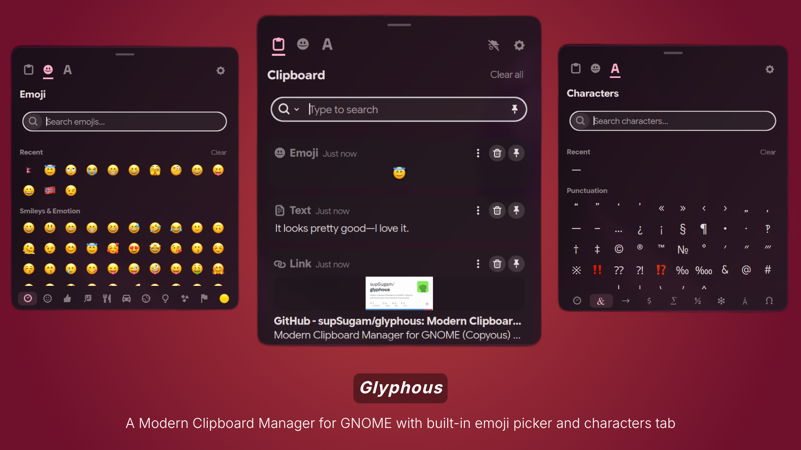

#  Glyphous

> All-in-one clipboard manager, emoji picker, and character map for GNOME.



## Features

### Clipboard Manager
- Supports text, code, images, files, links, and colors
- Open at mouse pointer or text cursor position
- Pin favorite items
- Group items with 9 colored tags
- Customizable clipboard actions
- Incognito mode

### Emoji Picker
- Browse and search the full Unicode emoji set
- Skin tone selector
- Recently used emojis
- Copy emoji or insert directly

### Character Map
- Browse Unicode character categories
- Search by name or codepoint
- Recently used characters
- Copy character or codepoint

## Installation

The extension requires the following dependencies for full functionality:
- Libgda 5.0 or 6.0 with SQLite support
- GSound

<details>
<summary>Install dependencies</summary>

| Distro        | Command                                                                             |
|---------------|-------------------------------------------------------------------------------------|
| Fedora        | `sudo dnf install libgda libgda-sqlite`                                             |
| Arch Linux    | `sudo pacman -S libgda6`                                                            |
| Ubuntu/Debian | `sudo apt install gir1.2-gda-5.0 gir1.2-gsound-1.0`                                |
| openSUSE      | `sudo zypper install libgda-6_0-sqlite typelib-1_0-Gda-6_0 typelib-1_0-GSound-1_0` |

</details>

### One-line Install / Update

```bash
curl -fsSL https://raw.githubusercontent.com/supSugam/glyphous/main/install.sh | bash
```

This downloads the latest release, installs it, and prints next steps. Run the same command again at any time to update.

After installing:
1. Log out and log back in *(required for first install on Wayland)*
2. Enable the extension:
   ```shell
   gnome-extensions enable glyphous@supsugam.github.com
   ```
   Or open the **Extensions** app and toggle Glyphous on.

### From Source

1. Install prerequisites:
   - Make
   - Node.js
   - [pnpm](https://pnpm.io/installation)
   - [jq](https://jqlang.org/)
2. Clone the repository:
   ```shell
   git clone --recurse-submodules https://github.com/supSugam/glyphous
   cd glyphous
   ```
3. Install dependencies and build:
   ```shell
   pnpm install
   make install
   ```
4. Log out and log back in.
5. Enable the extension:
   ```shell
   gnome-extensions enable glyphous@supsugam.github.com
   ```

## Configuration

Open extension settings via the panel indicator, [Extension Manager](https://flathub.org/en/apps/com.mattjakeman.ExtensionManager), or:
```shell
gnome-extensions prefs glyphous@supsugam.github.com
```

## Shortcuts

Key shortcuts for common actions. Most can be customized in extension settings.

| Description           | Shortcut                                                                                                       |
|-----------------------|----------------------------------------------------------------------------------------------------------------|
| Open Clipboard Dialog | <kbd>Super</kbd> <kbd>Shift</kbd> <kbd>V</kbd>                                                                 |
| Toggle Incognito Mode | <kbd>Super</kbd> <kbd>Shift</kbd> <kbd>Ctrl</kbd> <kbd>V</kbd>                                                 |
| Copy Item             | <kbd>Enter</kbd> / <kbd>Space</kbd>                                                                            |
| Run Default Action    | <kbd>Ctrl</kbd> <kbd>Enter</kbd> / <kbd>Space</kbd>                                                            |
| Pin Item              | <kbd>Ctrl</kbd> <kbd>S</kbd>                                                                                   |
| Delete Item           | <kbd>Delete</kbd> (hold <kbd>Shift</kbd> to force delete)                                                      |
| Navigation            | <kbd>Tab</kbd> / <kbd>↑</kbd> / <kbd>↓</kbd> / <kbd>←</kbd> / <kbd>→</kbd> / <kbd>Home</kbd> / <kbd>End</kbd> |
| Jump to Item          | <kbd>Ctrl</kbd> <kbd>0</kbd>...<kbd>9</kbd>                                                                    |
| Toggle Pinned Search  | <kbd>Alt</kbd>                                                                                                 |
| Cycle Item Type       | <kbd>Ctrl</kbd> <kbd>Tab</kbd> / <kbd>Shift</kbd> <kbd>Ctrl</kbd> <kbd>Tab</kbd>                               |
| Cycle Item Tag        | <kbd>Ctrl</kbd> <kbd>\`</kbd> / <kbd>Shift</kbd> <kbd>Ctrl</kbd> <kbd>\`</kbd>                                 |

## DBus

**Name:** `org.gnome.Shell.Extensions.Glyphous`
**Path:** `/org/gnome/Shell/Extensions/Glyphous`

| Method         | Arguments                                                                                                    | Description                       |
|----------------|--------------------------------------------------------------------------------------------------------------|-----------------------------------|
| `Toggle`       |                                                                                                              | Show or hide the clipboard dialog |
| `Show`         |                                                                                                              | Show the clipboard dialog         |
| `Hide`         |                                                                                                              | Hide the clipboard dialog         |
| `ClearHistory` | `all`:<br/>&emsp; if `true`, clears all history; <br/>&nbsp;&emsp;if `false`, clears unpinned/untagged items | Clear clipboard history           |

### Examples
```shell
gdbus call --session \
    --dest org.gnome.Shell.Extensions.Glyphous \
    --object-path /org/gnome/Shell/Extensions/Glyphous \
    --method org.gnome.Shell.Extensions.Glyphous.Toggle
```
```shell
gdbus call --session \
    --dest org.gnome.Shell.Extensions.Glyphous \
    --object-path /org/gnome/Shell/Extensions/Glyphous \
    --method org.gnome.Shell.Extensions.Glyphous.ClearHistory false
```

## Contributing
See [CONTRIBUTING.md](./CONTRIBUTING.md) for more information.

## Acknowledgments
Glyphous is a fork of [Copyous](https://github.com/boerdereinar/copyous) by Boerde Einar, which itself is a full rewrite of [Pano](https://github.com/oae/gnome-shell-pano).

## License
This project is licensed under the **GNU General Public License v3 or later**. See [LICENSE](./LICENSE) for details.
